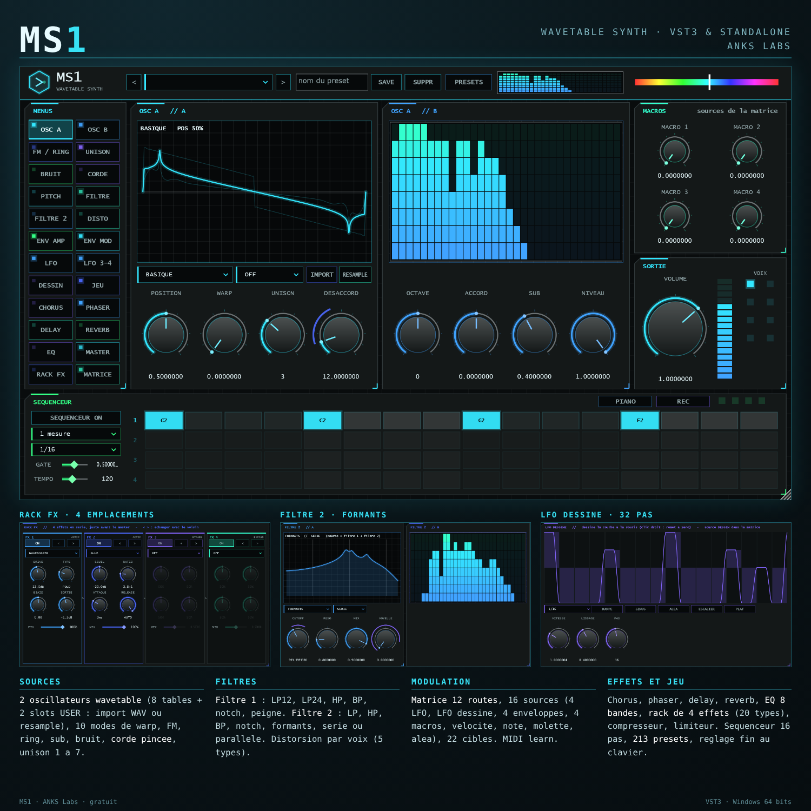

# MS1
### Synthé à table d'onde · VST3 & Standalone · Windows 64 bits

**ANKS Labs**

---

## Télécharger

1. Clique sur le bouton vert ci-dessus, puis sur le fichier **`MS1-vX-Windows.zip`** (pas besoin de compte).
2. Décompresse le zip (clic droit, *Extraire tout*).
3. Copie le dossier **`MS1.vst3`** dans `C:\Program Files\Common Files\VST3`.
4. Dans Ableton : *Préférences → Plug-ins → Rescan*. MS1 apparaît sous **VST3 → ANKS Labs**.

Sans logiciel de musique, lance simplement `MS1-Standalone.exe`. Le numéro de version est affiché à côté du logo dans le plugin.

> **Version de test** : MS1 est complet mais encore en développement. Des bugs et des niveaux à ajuster sont possibles, les retours sont les bienvenus.

## Présentation

MS1 est un synthé à table d'onde, **léger et gratuit**, pensé pour faire vite des sons puissants dans Ableton Live (ou n'importe quelle autre hôte VST3). Il s'inspire de l'esprit de Massive et de Serum (oscillateurs, modulation partout, effets) mais reste compact, avec des menus plutôt qu'un mur de potards.

Il est écrit en C++ avec JUCE par **ANKS Labs**, sans reprendre ni code ni interface d'un autre produit.

## Ce que fait MS1

### Sources
- **2 oscillateurs à table d'onde** (A et B) : **24 tables d'usine** (8 classiques calculées + 16 tables riches de jusqu'à 64 formes d'onde : choeur, FM, orgue, piano, cordes, vents, granulaire, disto, chip, basses, guitares…) + 2 emplacements **USER** (import WAV ou resample), 10 modes de warp.
- **Sub**, **bruit**, et **corde** (Karplus-Strong).
- **Résonateur modal** (12 modes) : corde, barre, marimba, cloche, tube, plaque, bol. Excité par une impulsion ou par le bruit en continu, avec position d'excitation, étirement (inharmonicité) et amortissement.
- **Timbre qui évolue** (brillant à l'attaque, plus doux ensuite) et **suivi de clavier** du filtre et du volume.
- Tables d'ondes à **20 niveaux de bande limitée** (demi-octave) et interpolation cubique : oscillateurs propres sur tout le clavier.
- **FM** et **modulation en anneau** entre A et B.
- **Unison** de 1 à 7 voix, **drive** avant filtre.
- **Réglage Qualité** (page MASTER) : *Éco* (le plus léger), *Normal* (suréchantillonnage 2x, son plus propre en FM, warp et distorsion), *Haute* (4x sur les oscillateurs).
- **Resample** : MS1 s'enregistre lui-même et réinjecte le résultat comme table d'onde.

### Filtres
- **Filtre 1** : LP12, LP24, HP, BP, notch, peigne.
- **Filtre 2** : LP, HP, BP, notch, **formants** (voyelles). Les deux filtres se montent en série ou en parallèle.
- **Distorsion par voix** après les filtres (5 types).

### Modulation
- **Enveloppe d'amplitude** et **enveloppe de modulation**.
- **4 LFO** (formes, vitesse libre ou synchro).
- **LFO dessiné** : tu traces la forme à la souris (32 points), avec formes prédéfinies et synchro.
- **4 macros**.
- **Matrice de modulation à 12 routes** : 16 sources (LFO, LFO dessiné, enveloppes, macros, vélocité, note, molette, aléa…) vers 22 cibles.

### Effets
- Chaîne globale : **chorus / flanger → phaser → delay → reverb (réseau de retards à 8 lignes) → EQ 8 bandes**.
- **Rack FX à 4 emplacements** (ordre modifiable) avec 20 effets :

| Famille | Effets |
|:--|:--|
| Dégradation et couleur | Bitcrusher, Lo-Fi, Waveshaper, Exciter |
| Modulation | Ring mod, Décaleur de fréquence, Rotary, Pan/Trémolo, Autowah |
| Filtres et résonances | Résonateur, Formants, Bande |
| Rythme et espace | Gate, Stutter, Shimmer, Imager |
| Dynamique | Limiteur, Compresseur, Glue, Maximizer |

- Fin de chaîne : compresseur, largeur stéréo, master, limiteur.

### Jeu
- **Séquenceur pas à pas** (16 pas par mesure, jusqu'à 4 mesures).
- **39 presets d'usine** en 6 familles (basses, nappes, leads, cordes, percussions, textures), niveaux calibrés et contrôlés par mesure.
- **MIDI learn** sur n'importe quel potard.

## Raccourcis et ergonomie

Survole un potard avec la souris : sa **valeur réelle** s'affiche dans la barre du bas.

| Action | Effet |
|:--|:--|
| `Haut` / `Bas` | Une unité (1, 0,1 ou 0,01 selon l'étendue). `Maj` : x10 |
| `Gauche` / `Droite` | Réglage fin : 0,25 % de la course. `Maj` : 2,5 % |
| Clic droit sur un potard | Entrer une valeur, valeur par défaut, **MIDI learn**, modulation rapide (macros, LFO, enveloppes) |
| `Tab` / `Maj+Tab` | Menu suivant / précédent |
| `Page haut` / `Page bas` | Preset précédent / suivant |
| `Echap` | Annule un MIDI learn |
| `<` `>` dans le rack FX | Changer l'ordre des 4 emplacements |

**MIDI learn** : clic droit sur un potard, puis bouge un contrôleur MIDI. Le CC est mémorisé dans `ANKS Labs/MS1/midimap.txt` et vaut pour tous les projets.

Dans certains hôtes, le clavier de l'ordinateur ne parvient pas toujours à la fenêtre du plugin. Clique d'abord dans l'interface.

## Pour les développeurs

- Code dans `Source/`, projet CMake (JUCE 8.0.4, récupéré à la compilation).
- Compilation locale : `cmake -B build -A x64` puis `cmake --build build --config Release`.
- Workflows GitHub Actions (onglet Actions) :
  - **Build VST3** : compile à chaque modification (artefact de test, réservé aux développeurs).
  - **Release** : publie une version dans *Releases* (lancement manuel, avec le numéro de version).
  - **Preset check** : mesure chaque preset (niveau, silence, saturation).
  - **Snapshot** : génère des captures de l'interface.
- Les presets d'usine sont générés dans `Source/FactoryBank.cpp`.

## Droits et licence

Les 16 tables riches sont dérivées d'**AKWF (Adventure Kid Waveforms)** de Kristoffer Ekstrand, mises à disposition en **CC0** (domaine public) : https://github.com/KristofferKarlAxelEkstrand/AKWF-FREE

Projet **ANKS Labs**, distribué librement et gratuitement. Rendre un dépôt public n'accorde pas à lui seul de licence de réutilisation : vérifie la licence du dépôt et les conditions de **JUCE** avant toute redistribution. *Massive*, *Serum* et les noms associés appartiennent à leurs propriétaires ; MS1 n'a aucun lien avec ces produits.

---

**BUILD. BREAK. REWIRE. LISTEN.**

